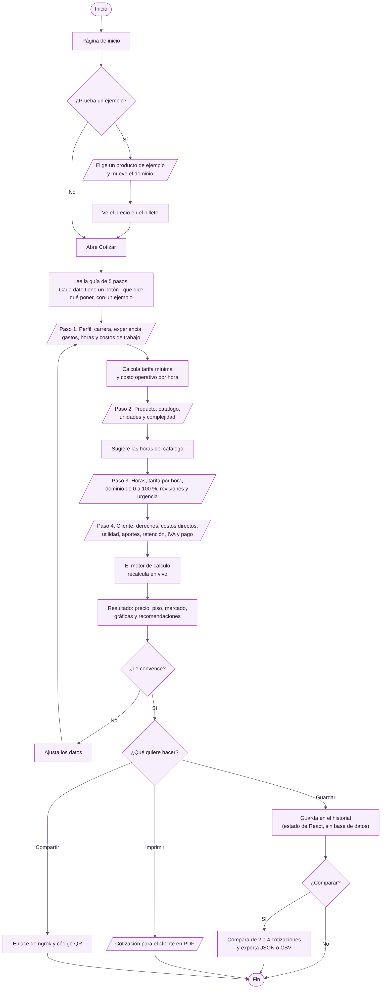
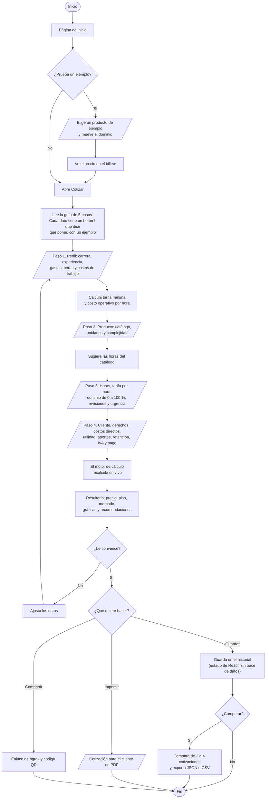
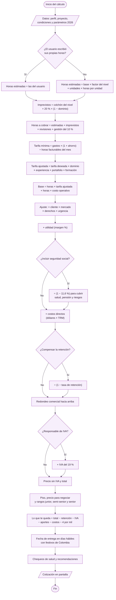
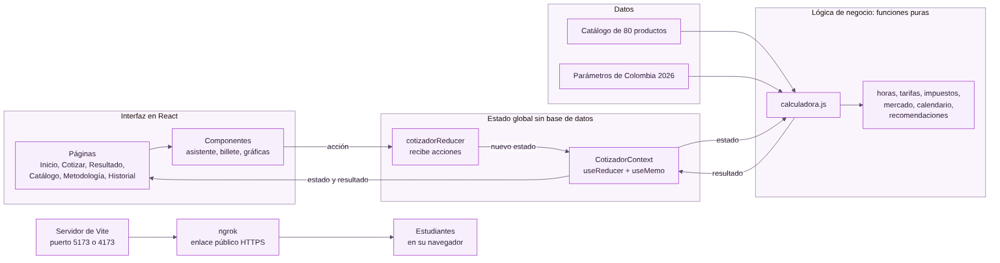
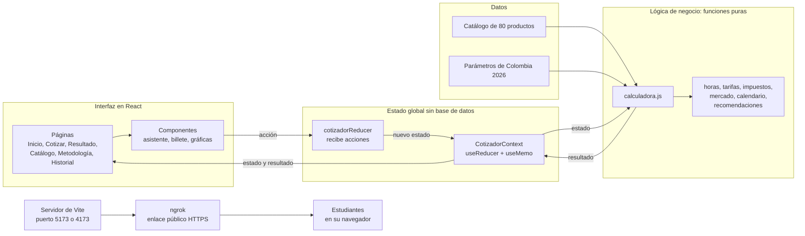
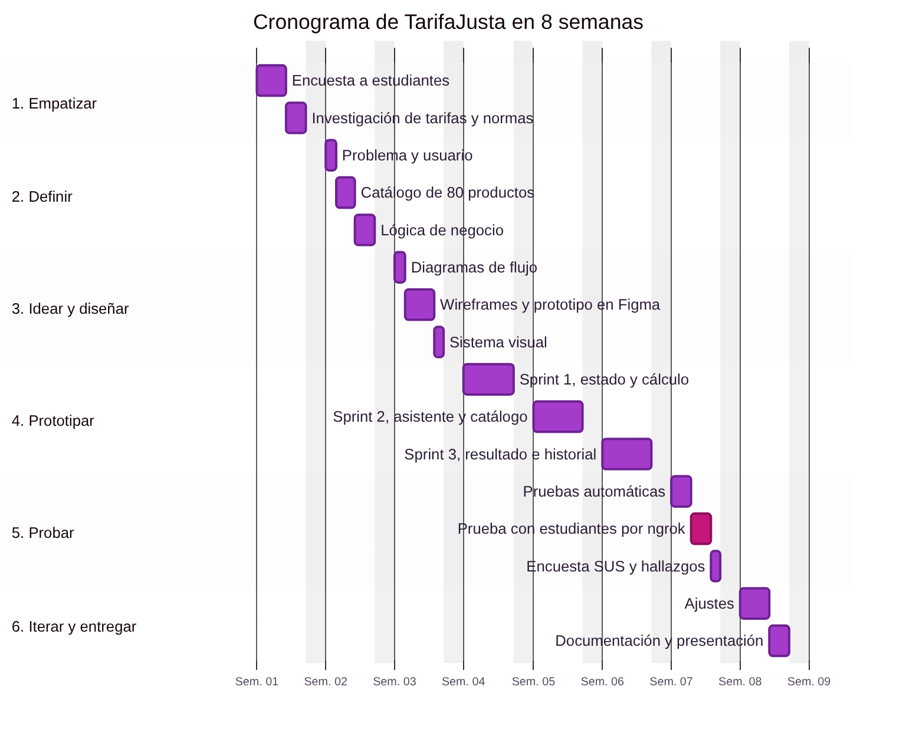
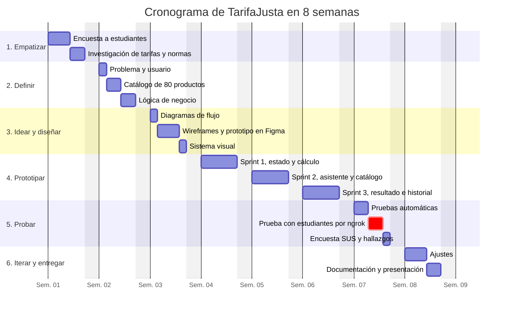

# Diagramas de flujo

Cuatro diagramas, cada uno en tres formatos dentro de `docs/diagramas/`:

- **`.png`**: para insertar en Word o en las diapositivas.
- **`.svg`**: vectorial, se ve nítido a cualquier tamaño. La app muestra estas versiones en las páginas "Cómo calculamos" y "El proyecto".
- **`.mmd`**: el código fuente en Mermaid, por si quieres editarlos.

Símbolos de los diagramas de flujo:

| Símbolo | Significado |
|---|---|
| Óvalo | Inicio o fin |
| Paralelogramo | Datos que entran o salen |
| Rombo | Decisión (sí o no) |
| Rectángulo | Proceso o cálculo |

## 1. Recorrido del usuario

Desde que abre la app hasta que guarda, imprime o comparte la cotización.





## 2. Lógica de cálculo del precio

Lo que hace `src/logica/calculadora.js` cada vez que cambia un dato. Ver el detalle de cada fórmula en [LOGICA_DE_NEGOCIO.md](LOGICA_DE_NEGOCIO.md).

```mermaid
flowchart TD
  A(["Inicio del cálculo"]) --> B[/"Datos: perfil, proyecto,
condiciones y parámetros 2026"/]
  B --> C{"¿El usuario escribió
sus propias horas?"}
  C -- Sí --> D["Horas estimadas = las del usuario"]
  C -- No --> E["Horas estimadas = base × factor del nivel
+ unidades × horas por unidad"]
  D --> F
  E --> F["Imprevistos = colchón del nivel
+ 20 % × (1 − dominio)"]
  F --> G["Horas a cobrar = estimadas + imprevistos
+ revisiones + gestión del 10 %"]
  G --> H["Tarifa mínima = gastos × (1 + ahorro)
÷ horas facturables del mes"]
  H --> I["Tarifa ajustada = tarifa deseada × dominio
× experiencia × portafolio × formación"]
  I --> J["Base = horas × tarifa ajustada
+ horas × costo operativo"]
  J --> K["Ajuste: × cliente × mercado
× derechos × urgencia"]
  K --> L["+ utilidad (margen %)"]
  L --> M{"¿Incluir seguridad social?"}
  M -- Sí --> N["÷ (1 − 11,6 %) para cubrir
salud, pensión y riesgos"]
  M -- No --> O
  N --> O["+ costos directos
(dólares × TRM)"]
  O --> P{"¿Compensar la retención?"}
  P -- Sí --> Q["÷ (1 − tasa de retención)"]
  P -- No --> R
  Q --> R["Redondeo comercial hacia arriba"]
  R --> S{"¿Responsable de IVA?"}
  S -- Sí --> T["+ IVA del 19 %"]
  S -- No --> U
  T --> U["Precio sin IVA y total"]
  U --> V["Piso, precio para negociar
y rangos junior, semi-senior y senior"]
  V --> W["Lo que te queda = total − retención − IVA
− aportes − costos − 4 por mil"]
  W --> X["Fecha de entrega en días hábiles
con festivos de Colombia"]
  X --> Y["Chequeos de salud y recomendaciones"]
  Y --> Z[/"Cotización en pantalla"/]
  Z --> FIN(["Fin"])
```





## 3. Arquitectura y flujo de datos

La interfaz despacha acciones al reducer; el nuevo estado pasa por el motor de cálculo y el resultado vuelve a la pantalla. Vite sirve la app y ngrok la publica para los estudiantes.





## 4. Cronograma





## Cómo volver a generar las imágenes

Con Node.js instalado, desde la carpeta del proyecto:

```bash
npx -p @mermaid-js/mermaid-cli mmdc -i docs/diagramas/flujo-calculo.mmd -o docs/diagramas/flujo-calculo.png -c docs/diagramas/mermaid-config.json -b white -s 2
```

Cambia el nombre del archivo para los otros diagramas, y usa `.svg` en la salida para la versión vectorial (luego cópiala a `public/diagramas/` para que la app la muestre). También puedes pegar el código en https://mermaid.live para editarlo en el navegador.
