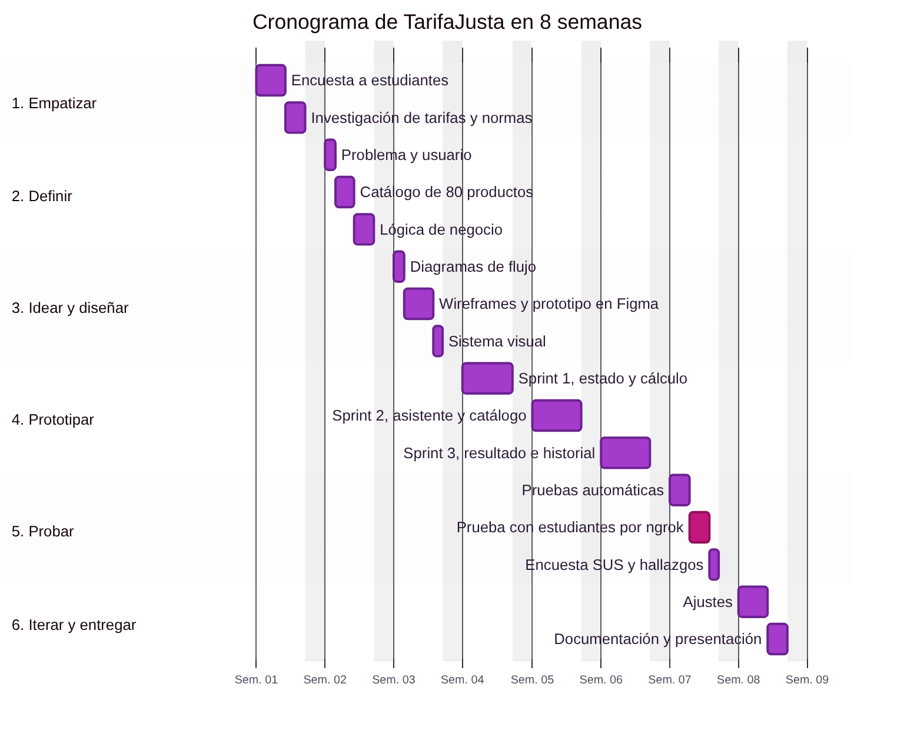

# Plan de trabajo: TarifaJusta

**Cotizador para recién egresados de Ingeniería de Sistemas e Ingeniería en Multimedia.**
Ingeniería en Multimedia, Universidad de Boyacá, Tunja, 2026. Autor: Yerson Leandro Ariza Chacón.

> Este archivo se genera con `npm run docs` a partir de `src/datos/planTrabajo.js`, el mismo que muestra la página "El proyecto" de la app.

## 1. Problema

Al graduarse, la mayoría de ingenieros de Sistemas y de Multimedia recibe sus primeros encargos sin saber cuánto cobrar. Ponen un precio al azar, copian el de un amigo o cobran tan poco que pierden dinero: olvidan los aportes a seguridad social, la retención en la fuente, las horas que no se pueden cobrar y el desgaste del equipo.

## 2. Objetivo general

Construir un prototipo web en React que calcule un precio justo para los productos de un recién egresado de Ingeniería de Sistemas o de Ingeniería en Multimedia, a partir de sus horas, la tarifa que quiere ganar y su nivel de especialidad en el tema, y validarlo con estudiantes por medio de un enlace público de ngrok.

## 3. Objetivos específicos

1. Construir un catálogo de 80 productos (32 de Sistemas y 48 de Multimedia) con unidad de medida y horas de referencia por complejidad.
2. Diseñar una lógica de negocio transparente que convierta horas, tarifa, especialidad (0 a 100 %) y condiciones comerciales en un precio sugerido, un piso y un rango de mercado.
3. Implementar la app con React y estado global (useReducer + Context), sin base de datos.
4. Documentar la lógica con diagramas de flujo y pruebas automáticas.
5. Publicar el prototipo con ngrok y medir su usabilidad con al menos 20 estudiantes.

## 4. Alcance

**Incluye:** catálogo, asistente de 4 pasos, cálculo en vivo, resultado con gráficas y recomendaciones, comparación con el mercado, historial en memoria con exportación JSON y CSV, cotización imprimible para el cliente, parámetros de Colombia 2026 editables y acceso remoto por ngrok.

**No incluye:** base de datos, cuentas de usuario, facturación electrónica ni asesoría tributaria. Las cifras son de referencia.

## 5. Metodología

Design Thinking por fases (empatizar, definir, idear, prototipar, probar) y, dentro de la fase de prototipo, tres sprints de una semana con entregas funcionales. Cada sprint termina con la app corriendo y las pruebas automáticas en verde.

## 6. Fases, actividades y entregables

| Fase | Semana | Actividad | Horas | Entregable |
|---|---|---|---|---|
| **1. Empatizar e investigar** | S1 | Encuesta a estudiantes y egresados sobre cómo ponen precio a su trabajo | 10 h | Informe de hallazgos y lista de productos a cotizar |
|  |  | Investigación de salarios, tarifas y normas de 2026 (salario mínimo, UVT, aportes, retención) | 8 h |  |
| **2. Definir** | S2 | Definición del problema y del usuario (recién egresado de Sistemas o Multimedia) | 4 h | Documento de lógica de negocio y catálogo de productos |
|  |  | Catálogo de 80 productos con unidad de medida y horas de referencia | 10 h |  |
|  |  | Diseño de la lógica de negocio y de las fórmulas | 8 h |  |
| **3. Idear y diseñar** | S3 | Diagramas de flujo del usuario y del cálculo | 4 h | Prototipo navegable y diagramas de flujo |
|  |  | Bocetos, wireframes y prototipo navegable en Figma | 10 h |  |
|  |  | Sistema visual: color, tipografía y componentes | 6 h |  |
| **4. Prototipar en React** | S4, S5, S6 | Sprint 1: proyecto con Vite, estado con useReducer y Context, motor de cálculo y pruebas | 16 h | Aplicación funcional en local |
|  |  | Sprint 2: asistente de 4 pasos, resumen en vivo y catálogo | 18 h |  |
|  |  | Sprint 3: resultado con gráficas, historial, cotización imprimible y metodología | 18 h |  |
| **5. Probar con estudiantes** | S7 | Pruebas unitarias del cálculo y revisión en celular y computador | 6 h | Informe de validación con estudiantes |
|  |  | Publicación con ngrok y sesión de prueba con 15 a 30 estudiantes | 6 h |  |
|  |  | Encuesta de usabilidad (SUS) y registro de hallazgos | 4 h |  |
| **6. Iterar y entregar** | S8 | Ajustes según la retroalimentación | 8 h | Versión 1.0, documentación y presentación |
|  |  | Documentación final y presentación | 6 h |  |
| | | **Total** | **142 h** | |

## 7. Cronograma

Semana 1 es la semana en que empiece el proyecto. El código del diagrama está en `docs/diagramas/cronograma.mmd`.

## 8. Recursos

| Recurso | Detalle | Costo |
|---|---|---|
| Equipo humano | 1 persona (desarrollo, diseño e investigación) | Horas del plan |
| Computador | Windows 11 con Node.js 22 o superior | Propio |
| Software | VS Code, Node.js, React, Vite, Vitest, Figma (plan gratuito) | $ 0 |
| Publicación | ngrok, plan gratuito (1 dominio de desarrollo, 1 GB al mes) | $ 0 |
| Validación | Formulario de encuesta SUS (Google Forms o Microsoft Forms) | $ 0 |

**Valor del trabajo calculado con la propia lógica de TarifaJusta:** 142 h estimadas de una aplicación web a la medida (6 módulos, nivel intermedio, 60 % de dominio, cliente entidad pública) darían un precio sugerido de **$ 9.170.000**, con un piso de $ 4.670.000 (198,8 h a cobrar a $ 30.210 por hora).

## 9. Riesgos y cómo se manejan

| Riesgo | Mitigación |
|---|---|
| El enlace de ngrok deja de funcionar si el PC se apaga o se cierra la ventana. | Dejar el PC encendido durante la prueba y tener a mano COMPARTIR_CON_NGROK.bat. |
| El plan gratuito de ngrok tiene límites de peticiones y de datos al mes. | Usar la versión compilada (más liviana) y hacer las pruebas en sesiones acotadas. |
| Las cifras de referencia (salario mínimo, dólar, tarifas) cambian con el tiempo. | Parámetros editables en la app y fuentes citadas en la metodología. |
| Que alguien tome el resultado como asesoría tributaria. | Aviso visible: son valores de referencia; los impuestos se confirman con un contador. |
| Sin base de datos, los datos se pierden al recargar. | Exportar e importar el historial en JSON o CSV e imprimir la cotización en PDF. |

## 10. Indicadores de éxito

- Al menos 20 estudiantes prueban la app por el enlace de ngrok.
- Puntaje de usabilidad SUS de 68 o más.
- Un estudiante nuevo obtiene su primera cotización en menos de 5 minutos.
- Al menos 8 de cada 10 participantes entienden de dónde sale el precio.
- Todas las pruebas automáticas del cálculo pasan.

## 11. Protocolo de prueba con estudiantes

1. **Antes:** ejecutar `COMPARTIR_CON_NGROK.bat`, proyectar el código QR y verificar el enlace desde un celular.
2. **Tarea guiada (5 minutos):** "Eres recién egresado y un cliente te pide un logotipo (Multimedia) o una landing page (Sistemas). Calcula cuánto cobrar y guarda la cotización."
3. **Tarea libre (5 minutos):** cotizar un producto real que el estudiante haya hecho o quiera vender.
4. **Encuesta SUS (10 preguntas, escala de 1 a 5)** más tres preguntas propias:
   - ¿Entendiste de dónde sale el precio? (sí, más o menos, no)
   - ¿El precio sugerido te pareció justo? (bajo, justo, alto)
   - ¿Qué cambiarías?
5. **Después:** calcular el puntaje SUS, agrupar los comentarios y priorizar los ajustes de la semana 8.

### Preguntas SUS en español

1. Creo que me gustaría usar esta herramienta con frecuencia.
2. Encontré la herramienta innecesariamente compleja.
3. Pensé que la herramienta era fácil de usar.
4. Creo que necesitaría ayuda de una persona técnica para poder usarla.
5. Las funciones de la herramienta están bien integradas.
6. Pensé que había demasiada inconsistencia en la herramienta.
7. Imagino que la mayoría de las personas aprendería a usarla muy rápido.
8. Encontré la herramienta muy difícil de usar.
9. Me sentí muy seguro usando la herramienta.
10. Necesité aprender muchas cosas antes de poder usarla.

Puntaje: a las preguntas impares se les resta 1; a 5 se le resta la respuesta de las pares; se suman y se multiplican por 2,5. Un resultado de 68 o más es aceptable.
